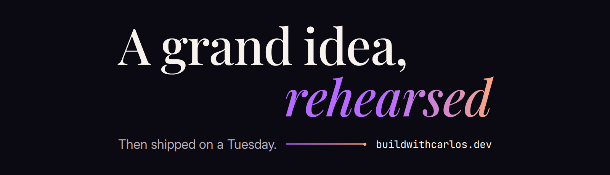

<picture>
  <source media="(prefers-color-scheme: dark)" srcset="./assets/header-dark.png">
  <source media="(prefers-color-scheme: light)" srcset="./assets/header-light.png">
  
</picture>

Before an interface ships, I decide how people will meet it: what they notice first, what they need to understand and what they should do next. Then I build it to hold up in production.

I'm a Frontend Engineer working with React, Next.js and TypeScript, currently a Product Engineer at Rudu. I started in marketing and communications, so I think about how people perceive an interface before I think about how to implement it, and then I implement it properly.

### Selected work

**[Brightfield Solar](https://github.com/CarlosHenriqueMkt/brightfield-solar)**  
A city landing page with a working solar estimate, an interactive Three.js house and a downloadable estimate PDF, built with the Next.js App Router. [See it live](https://brightfield-solar-three.vercel.app/city/phoenix-az).

**[AI Linear Workflow](https://github.com/CarlosHenriqueMkt/ai-linear-workflow)**  
Portable Linear commands that take one product request from discovery to a reviewed pull request, with auditable evidence along the way.

**[ENSO Brasil](https://github.com/CarlosHenriqueMkt/enso-brasil)**  
An open-source public dashboard, in Portuguese, that aggregates active climate threats by Brazilian state from official sources.

**3D studies**  
Experiments with Three.js and React Three Fiber: a [product customizer](https://github.com/CarlosHenriqueMkt/r3f-product-customizer), [scene transitions](https://github.com/CarlosHenriqueMkt/r3f-transition-study) and [immersive backgrounds](https://github.com/CarlosHenriqueMkt/threejs-immersive-background).

### Elsewhere

[buildwithcarlos.dev](https://buildwithcarlos.dev) | [LinkedIn](https://www.linkedin.com/in/carloshenriquerp) | [falacom.ocarlos@gmail.com](mailto:falacom.ocarlos@gmail.com)
